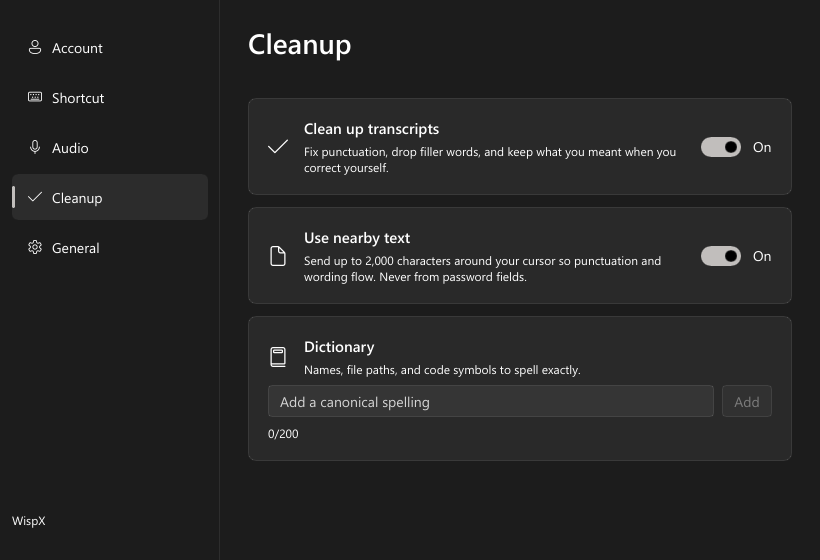

# WispX

[](https://github.com/PeytonWDYM/WispX/actions/workflows/build.yml)
[](https://github.com/PeytonWDYM/WispX/releases/latest)

Push-to-talk dictation for Windows and Linux. Hold **Ctrl + Win**, speak, let go. Your words are typed at the cursor.

**Listen** turns a meeting, call or video playing on your computer into a transcript and notes.

<p align="center"></p>

Transcribes with ChatGPT using your existing Codex sign-in. No API key needed.

## Install

- **Windows 10/11:** download `WispX.exe` from the [latest release](https://github.com/PeytonWDYM/WispX/releases/latest) and run it. If SmartScreen warns, click **More info → Run anyway**.
- **Linux:** unpack `WispX-linux-x86_64.tar.gz` somewhere permanent and run `WispX`. Run `WispX --diagnose` if something doesn't work.
- Requires the [Codex app](https://openai.com/codex/) (or CLI on Linux) signed in with ChatGPT.

## Use

| Keys | Action |
| --- | --- |
| Hold **Ctrl + Win** | Record, type on release |
| **Ctrl + Win**, then **Space** | Hands-free, press Ctrl + Win to finish |
| **Esc** | Cancel |
| **Ctrl + Shift + F8** | Listen: start, or stop and write notes |

Wayland/Plasma defaults: **Ctrl + Meta + D**, **Ctrl + Meta + Space**, **Ctrl + Meta + Backspace**.

Click the tray icon for **Options**:

- **Cleanup:** fixes punctuation and filler words
- **Dictionary:** names and terms to spell exactly
- **Stats:** word counts and speed
- Lowers other audio while you dictate

<p align="center"></p>

## Good to know

- Uses ChatGPT's private transcription endpoint. It can change without notice and may go against OpenAI's terms.
- ChatGPT keeps audio for 30 days.
- Listen sends long recordings as many requests. Rate limits on the private endpoints are unknown.
- Can't type into apps running as administrator.

## Build

```sh
cargo build --release
cargo fmt --check && cargo clippy --locked --all-targets -- -D warnings && cargo test --locked
```

Requires Rust 1.92+. Linux also needs `libasound2-dev pkg-config` (or your distro's equivalent).

## Credits

Options UI built with [Slint](https://slint.dev) under the [Slint Royalty-free License](https://slint.dev/license/royalty-free/2.0/).

[](https://slint.dev)
