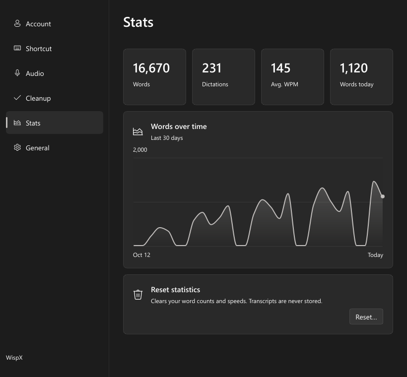
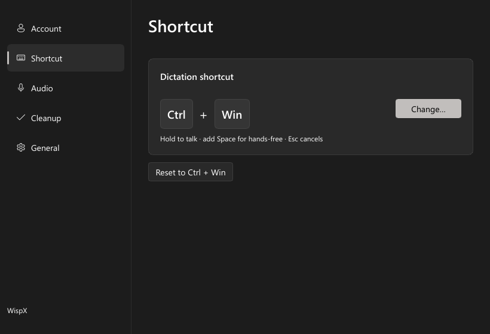
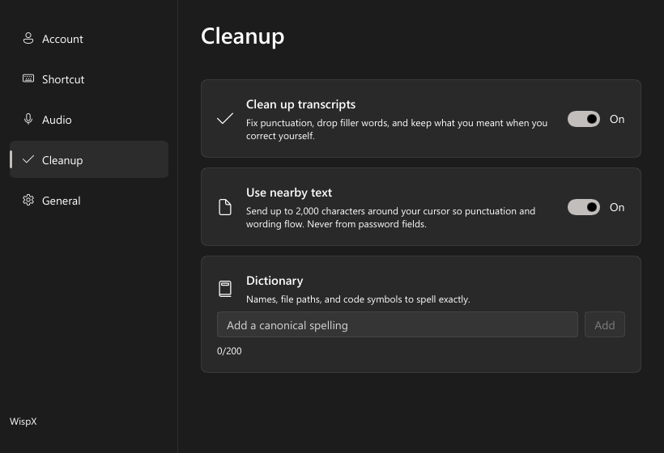

# WispX

[](https://github.com/PeytonWDYM/WispX/actions/workflows/build.yml)
[](https://github.com/PeytonWDYM/WispX/releases/latest)

Push-to-talk dictation for Windows and Linux (X11 or Wayland, with KDE Plasma support). Hold **Ctrl + Win**, speak, and let go. Your words are typed wherever the cursor is.

<p align="center"></p>

WispX transcribes with ChatGPT, just like the Dictate button in the ChatGPT and Codex apps. It reuses the sign-in the Codex app already saved on your PC, so you don't need an API key or a separate login.

## Install

On Windows, you need Windows 10 or 11 and the [Codex app](https://openai.com/codex/) signed in with your ChatGPT account.

1. Download `WispX.exe` from the [latest release](https://github.com/PeytonWDYM/WispX/releases/latest).
2. Run it. WispX installs itself, adds a Start menu entry, and starts in the system tray.

The exe isn't code-signed, so SmartScreen may warn you. Click **More info → Run anyway**. To update, run the newer `WispX.exe`.

On Linux, unpack `WispX-linux-x86_64.tar.gz` from the same release somewhere permanent, then run `WispX`. It adds an app launcher entry. Sign in to the Codex app or CLI with your ChatGPT account first.

Linux needs ALSA's `libasound.so.2`. On Wayland, global shortcuts need `xdg-desktop-portal` 1.18+ and a GlobalShortcuts backend, such as Plasma 6's `xdg-desktop-portal-kde`. The pill uses layer shell where available (including KWin), or XWayland otherwise. A StatusNotifierItem tray shows the tray menu; without one, launch WispX again to open Options. `WispX --diagnose` reports desktop support, and `WispX --uninstall` removes its launcher and sign-in entries.

## Use

| Keys | Action |
| --- | --- |
| Hold **Ctrl + Win** | Record while held, then type the text when released |
| **Ctrl + Win**, then **Space** | Hands-free. Press Ctrl + Win again to finish |
| **Esc** | Cancel |

Click the tray icon to open **Options**. From there you can change the shortcut, microphone, language, sounds, and startup behavior.

The **Stats** page shows word counts and dictation speed, with a chart of the last 30 days. It saves only counts and spoken time in `stats.json` next to your settings, never the text; you can reset it anytime.

<p align="center"></p>

<p align="center"></p>

### Linux shortcuts and pasting

On **X11**, shortcuts work as above; Win is the Super/Meta key. On **Wayland**, the desktop owns the shortcuts. Plasma can't bind a modifier-only chord, so the defaults are **Ctrl + Meta + D** to hold-to-talk, **Ctrl + Meta + Space** for hands-free (press either shortcut again to finish), and **Ctrl + Meta + Backspace** to cancel. **Change…** opens the desktop's shortcut settings.

Plasma asks you to confirm shortcuts and allow keyboard remote control on first start. WispX pastes only if the original window still has focus, using XTEST on X11 or KWin focus checks and the RemoteDesktop portal on Plasma Wayland. Other Wayland desktops fall back to copying for you to paste manually. Terminals get Ctrl + Shift + V. After a paste, your previous clipboard is restored unless you copied something newer.

### Cleanup

Cleanup is on by default. It runs a second pass that fixes punctuation, removes filler words, and keeps what you meant when you correct yourself mid-sentence. If cleanup fails or takes too long, WispX types the original transcript.

- **Use nearby text** (Windows only) sends up to 2,000 characters around your cursor so the new text fits what's already there. It never reads password fields. In VS Code, turn on **Editor: Accessibility Support** so WispX can see the text. Linux cleanup runs without nearby text.
- **Dictionary** holds names, file paths, and code symbols that cleanup should spell exactly.

<p align="center"></p>

## Good to know

- WispX uses ChatGPT's private transcription endpoint. It isn't a public API, so it can change without notice, and using it may go against OpenAI's terms.
- ChatGPT keeps the audio for 30 days, the same as its built-in dictation.
- WispX reads your Codex sign-in from `%USERPROFILE%\.codex\auth.json` (`~/.codex/auth.json` on Linux). When the token expires, WispX refreshes it so Codex stays signed in.
- Windows doesn't let WispX type into apps running as administrator.

## Build from source

Requires Rust 1.92+ and, on Windows, the Visual Studio C++ build tools with the Windows SDK.

On Linux, install ALSA development files and `pkg-config`: `libasound2-dev pkg-config` on Debian/Ubuntu, `alsa-lib pkgconf` on Arch, or `alsa-lib-devel` on Fedora. Cargo selects the platform from the build target.

```sh
cargo build --release              # target/release/WispX.exe (Windows) or WispX (Linux)
target/release/WispX.exe --portable  # run without installing
```

Explicit targets:

```sh
cargo build --release --target x86_64-unknown-linux-gnu
cargo build --release --target x86_64-pc-windows-msvc  # on Windows
cargo build --release --target x86_64-pc-windows-gnu   # with MinGW
```

Before opening a PR, run the checks:

```sh
cargo fmt --check
cargo clippy --locked --all-targets -- -D warnings
cargo test --locked
```

`scripts/e2e.ps1` runs the end-to-end test. It needs Microsoft Edge, `ffmpeg` and `ffprobe` on PATH, and a signed-in Codex app. The test synthesizes speech and transcribes it with the real endpoint. Then it checks cleanup and dictionary correction, tests reading nearby text in a throwaway Edge profile, and screenshots the UI. Everything it produces goes to `artifacts/e2e/`. `scripts/context-editors.ps1` runs a similar nearby-text check against VS Code and Notepad.

On Linux, `bash scripts/ci-linux.sh` runs the checks, builds the Linux app, paints the pill offscreen, and cross-compiles the Windows exe. It downloads Rust, MinGW and any missing ALSA development packages into user-owned directories without sudo. `scripts/linux-smoke.sh` checks startup and UI in a private headless Plasma session; `cargo test --test linux_nested -- --ignored --nocapture --test-threads=1` exercises shortcuts and pasting there.

CI builds every push and pull request. Pushing a `v*` tag publishes a release.

### Project layout

```
src/
  app.rs             dictation controller
  hotkey*.rs         shortcut model and key state machine
  audio/             recording, Opus/WebM encoding, cue sounds
  transcribe/        Codex auth, ChatGPT transcription, cleanup
  ui/                Options window logic
  platform/windows/  keyboard hook, tray, pill overlay, installer
  platform/linux/    X11/portal shortcuts, clipboard, paste, tray, pill, autostart
ui/                  Slint layouts for Options
scripts/             E2E tests, Linux smoke test and cross-build
```

## Credits

The Options window is built with [Slint](https://slint.dev) under the [Slint Royalty-free License](https://slint.dev/license/royalty-free/2.0/).

[](https://slint.dev)
